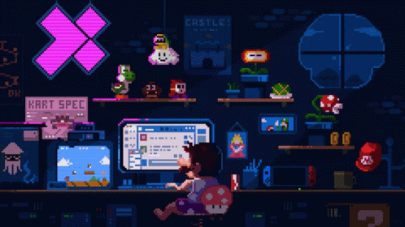

<!-- 1. BANNER -->

  

<!-- 2. LINKS DE REDES SOCIAIS / CONTATO (BADGES ESTILO BENJAMÍN) -->

  
  
  

<!-- 3. SEÇÃO SOBRE MIM (COM GIF ALINHADO À DIREITA) -->
## 🕵️‍♂️ Sobre Mim ~

<table border="0">
  <tr>
    <td width="75%" valign="top">
      <h3>Olá, eu sou o João Ricardo Assis Fornari 👋</h3>
      
Estou estudando atualmente <b>Análise e Desenvolvimento de Sistemas (ADS)</b> na FATEC Ribeirão Preto. Possuo conhecimentos em análise e visualização de dados, banco de dados, lógica de programação e ferramentas voltadas à tomada de decisão baseada em dados.

      <ul>
        <li>🎓 Estudante na <b>FATEC Ribeirão Preto</b></li>
        <li>💻 Explorando o mundo de Análise de Dados</li>
        <li>🌱 Focado em aprender novas linguagens e ramos da IA</li>
      </ul>
    </td>
    <td width="80%" align="right">
      <!-- Aqui você pode pôr um GIF pixel-art ou alguma imagem do seu gosto. Exemplo abaixo: -->
      
    </td>
  </tr>
</table>

<!-- 4. SEÇÃO DE TECNOLOGIAS (BADGES DO SHIELDS.IO) -->
## ⚙️ Tecnologias ~

  <!-- Frontend -->
  
  
  
  
   
  <!-- Backend & BD -->
  
  
  
  
   
  <!-- Ferramentas -->
  
  

<!-- 5. ESTATÍSTICAS DO GITHUB (DINÂMICAS) -->
## 📊 Estatísticas ~

  <!-- Seus dados dinâmicos do GitHub vinculados ao seu usuário J-Fornari -->
  

 

<!-- 6. GRÁFICO DE CONTRIBUIÇÃO (OPCIONAL) -->

  

<!--
## Olá, Sejam Bem Vindos👋

Estudante de Análise e Desenvolvimento de sistema pela Fatec de Ribeirão Preto. Possuo conhecimentos em análise e visualização de dados, banco de dados, lógica de programação e ferramentas voltadas à tomada de decisão baseada em dados.

##

<h3 align="left">Connect with me ~</h3>

<h3 align="left">My Stack ~</h3>

 
  
  
  
  
  
  
  
  
  
  
  

##

 <h2>~ GitHub Stats ~
 

<picture align="center">
  <source media="(prefers-color-scheme: dark)" srcset="https://raw.githubusercontent.com/J-Fornari/J-Fornari/output/github-contribution-grid-snake-dark.svg">
  <source media="(prefers-color-scheme: light)" srcset="https://raw.githubusercontent.com/J-Fornari/J-Fornari/output/github-contribution-grid-snake-dark.svg">
  
</picture>

<!--
Aqui deixarei uma mensagem invisível para caso precise! 😄
-->
